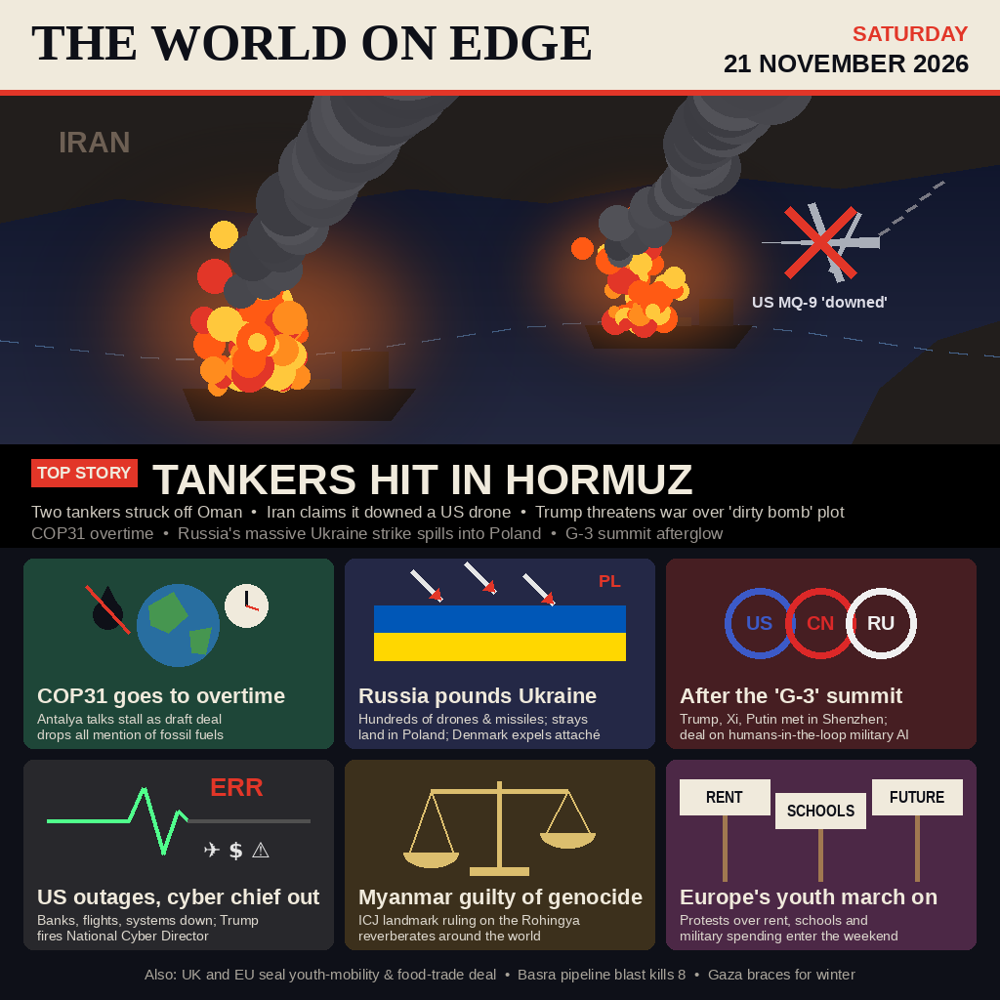

# The World on Edge — 21 November 2026

A single 1024×1024 front-page poster that sums up the world's news of
Saturday 21 November 2026, built for the make.fun bounty
**news-image-20261121**.

## How it runs

`python3 main.py` copies `entry.png` to `$MAKEFUN_OUTPUT_DIR/entry.png`
(` /output/entry.png` when the variable is unset). It uses only the
standard library, needs no network, and refuses to hand in an image over
the 1 MiB limit.

The poster itself is drawn with Pillow by `tools/draw.py` — run
`python3 tools/draw.py` to regenerate `entry.png` from scratch.

## What the poster covers

**Lead story — tankers hit in the Strait of Hormuz.** A second tanker was
struck by an unknown projectile 11 nautical miles north of Oman's Khasab
on Saturday, a day after a first tanker was hit 8 nautical miles north of
the same port and caught fire. Iran's IRGC said it shot down a US MQ-9
drone over the strait, its 58th, and US–Iran talks stalled as Trump called
Tehran's terms unacceptable.

- **COP31 runs into overtime.** The UN climate talks in Antalya, Turkey
  ran past their Friday deadline into Saturday, deadlocked after a draft
  deal dropped all mention of fossil fuels and a $120 billion
  adaptation-finance target; a third draft was promised for Saturday
  morning.
- **Russia pounds Ukraine.** After one of the war's largest barrages —
  400+ drones and 110+ missiles, at least 8 killed, Kyiv's bridges hit —
  Russian missiles and a drone came down in Poland. NATO called it a grave
  violation and Denmark expelled Russia's defence attaché over an alleged
  assassination plot.
- **After the "G-3" summit.** Fallout from the Trump–Xi–Putin meeting in
  Shenzhen on 19 November, including a US–China agreement that humans must
  stay in the loop for military AI decisions, and a joint condemnation of
  the International Criminal Court.
- **US outages, cyber chief out.** Trump confirmed firing National Cyber
  Director Sean Cairncross after a week of outages hit banks, flights,
  Microsoft, Apple and the NSA's internal systems; Kirsten Davies of the
  Pentagon takes over.
- **Myanmar guilty of genocide.** The ICJ ruled 9–6 on 19 November that
  Myanmar committed genocide against the Rohingya — the first time the
  World Court has found a state guilty of genocide — and ordered
  reparations.
- **UK and EU seal a reset deal.** At a Brussels summit on 20 November the
  two sides agreed youth mobility for 100,000 people a year, eased food
  trade and linked carbon markets — the biggest step towards closer ties
  since Brexit.
- **Also in the footer:** a gas pipeline blast at the Hartha power station
  near Basra killed at least 4; US–Iran talks stalled as Hormuz attacks
  continued; NATO's chief was due in Warsaw after the Poland incursion.

Sources checked against: Reuters, AP, CNN, The Guardian, BBC, Al Jazeera,
The Times, WSJ, Human Rights Watch, UKMTO, Le Monde.

## License

MIT — see [LICENSE](LICENSE).

---

Made for [make.fun](https://make.fun/?ref=vbrytm16)
